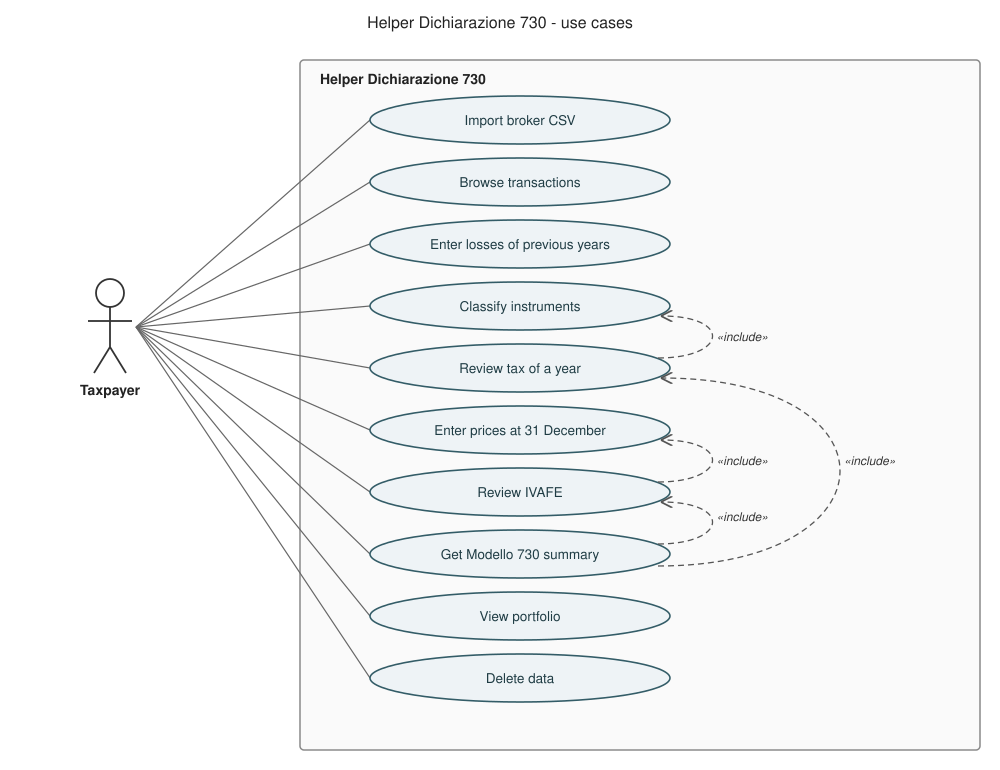

# Requirements

## User stories

The system has a single role, the **taxpayer**: an Italian tax resident who invests
through a foreign broker under the self-reporting regime.

**Persona.** _Giulia, 29, software developer._ She buys ETFs and a few shares with
Revolut every month and gets some dividends. She is comfortable with apps but not with tax
law. Every spring she has to fill in her Modello 730 and does not know which numbers go
where, nor how to compute them from her broker statement.

| ID    | As a taxpayer, I want to…                                               | so that…                                               |
| ----- | ----------------------------------------------------------------------- | ------------------------------------------------------ |
| US-1  | upload the CSV exported by my broker                                    | I do not have to copy my transactions by hand.         |
| US-2  | upload the same file again, or a newer one, without creating duplicates | I can keep my data up to date without worrying.        |
| US-3  | see which rows of the file could not be imported, and why               | I can fix them or know what is missing.                |
| US-4  | tell the application once what kind of instrument each ticker is        | the right tax rules are applied to it.                 |
| US-5  | see the substitute tax I owe for a year, split by income category       | I know how much I will pay.                            |
| US-6  | see the losses I can still use and when they expire                     | I do not lose the right to offset them.                |
| US-7  | enter the losses I realized before I started using the application      | they are taken into account.                           |
| US-8  | see how every gain was computed, down to the purchases it comes from    | I can check the result and justify it if asked.        |
| US-9  | get the IVAFE on my foreign holdings                                    | I pay the wealth tax due without computing it by hand. |
| US-10 | get the values to write in each box of the Modello 730                  | filling in the return is a matter of copying numbers.  |
| US-11 | be warned about the cases the application cannot handle                 | I know when I need to check something myself.          |
| US-12 | see my current portfolio                                                | I have an overview of what I hold.                     |
| US-13 | use the application in Italian or English                               | I can use the language I prefer.                       |
| US-14 | delete all my data                                                      | I can start again from scratch.                        |

## Requirements analysis

### Functional requirements

| ID    | Requirement                                                                                                                                                                                                                                             | Acceptance criteria                                                                                                                                                                  |
| ----- | ------------------------------------------------------------------------------------------------------------------------------------------------------------------------------------------------------------------------------------------------------- | ------------------------------------------------------------------------------------------------------------------------------------------------------------------------------------ |
| FR-1  | The system imports the transaction CSV of Revolut and Trade Republic, recognising the broker from the file header.                                                                                                                                      | Uploading each sample export imports all its valid rows; a file of an unknown format is rejected with a message naming the supported brokers.                                        |
| FR-2  | Importing is idempotent.                                                                                                                                                                                                                                | Uploading the same file twice adds no transaction the second time and reports the rows as duplicates.                                                                                |
| FR-3  | Each row is validated; invalid rows are skipped and reported with their row number and the reason, without stopping the import.                                                                                                                         | A file with a malformed amount, an unknown operation type, a non-EUR currency, a corporate action or a future date imports the other rows and lists each faulty row with its reason. |
| FR-4  | The user classifies each instrument by asset class (share, bond, white-list or other government bond, UCITS ETF, non-UCITS ETF, ETC/ETN), with the share of government bonds for UCITS ETFs and the foreign withholding rate for dividends and coupons. | Values outside 0–100% are rejected; a government bond share can be set only on a UCITS ETF.                                                                                          |
| FR-5  | No tax is computed while an instrument involved in the year is unclassified.                                                                                                                                                                            | Requesting the tax of a year lists every unclassified instrument it needs, all at once.                                                                                              |
| FR-6  | Sales of shares, bonds and ETCs/ETNs are matched to purchases with LIFO; their tax cost and proceeds include fees.                                                                                                                                      | For two purchases followed by a partial sale, the cost of the sale comes from the most recent purchase, fees included.                                                               |
| FR-7  | Sales of fund units are valued at the weighted average cost, without fees.                                                                                                                                                                              | For a UCITS ETF bought at two prices, the cost of a sale equals the quantity sold times the average price.                                                                           |
| FR-8  | Gains and income are classified as miscellaneous income (_redditi diversi_) or capital income (_redditi di capitale_), following the asset class.                                                                                                       | A UCITS ETF sold at a gain gives capital income, at a loss miscellaneous income; dividends and coupons give capital income.                                                          |
| FR-9  | Income from white-list government bonds, directly or through UCITS ETFs, is taxed at an effective 12.5%.                                                                                                                                                | A gain of 100 on a white-list government bond gives a taxable amount of 48.08; for an ETF with 40% in government bonds, 79.23.                                                       |
| FR-10 | The substitute tax of a year is computed at 26% on each income category; a total below 12 euro is shown as not payable.                                                                                                                                 | Taxable amounts and tax per category match the hand-computed values on the sample files.                                                                                             |
| FR-11 | Miscellaneous gains and losses of a year are netted; a net loss can offset miscellaneous gains of the following four years, oldest first; capital income is never offset.                                                                               | A loss of 2022 is used before one of 2023 and is no longer available in 2027; dividends are taxed in full even when losses are available.                                            |
| FR-12 | The user can enter losses realized before the first import; the system warns when a loss refers to a year already imported or expired before it.                                                                                                        | Saved losses enter the carryforward of their year; the warnings appear without blocking the save.                                                                                    |
| FR-13 | For every sale, the system shows the purchase lots it consumed, with quantity, cost and proceeds of each.                                                                                                                                               | The costs and proceeds of the lots shown add up to those of the sale.                                                                                                                |
| FR-14 | The system computes the IVAFE of a year at 0.2% of the market value, pro rata on the days each holding was owned; the user enters the prices at 31 December.                                                                                            | A holding bought on 1 July and kept until 31 December pays 184/365 of the yearly tax; a holding without a price is listed as missing.                                                |
| FR-15 | The system builds the values of quadri T, M and W of the Modello 730 for a year, with warnings for the cases it cannot handle.                                                                                                                          | On the sample files, the proceeds and costs in T11, the lines of M31 and the rows of W match the expected values; a non-UCITS ETF produces a warning.                                |
| FR-16 | The system shows the current portfolio at cost, by instrument and by asset class.                                                                                                                                                                       | The quantities shown equal purchases minus sales for every instrument.                                                                                                               |
| FR-17 | The user can delete all imported transactions and the import history, and optionally the prices at 31 December and the instruments left unused, after a confirmation. | After confirming, no transaction and no import is left; cancelling leaves the data untouched. |
| FR-18 | The interface and the messages of the system are available in Italian and English.                                                                                                                                                                      | Switching language translates all labels, warnings and error messages.                                                                                                               |

### Non-functional requirements

| ID    | Requirement                                                                                                                 | Acceptance criteria                                                                                                  |
| ----- | --------------------------------------------------------------------------------------------------------------------------- | -------------------------------------------------------------------------------------------------------------------- |
| NFR-1 | **Correctness of amounts.** Amounts are computed with exact decimals, never floating point; intermediate values keep 10 decimals and each result is rounded to cents. | Partial sales of the same lot always add up exactly to its original cost. |                                          |
| NFR-2 | **Traceability.** Every figure can be traced back to the transactions that produced it.                                     | Each taxable event links to its source transaction and file row.                                                     |
| NFR-3 | **Consistency.** Results always reflect the current data.                                                                   | After a new import or a change of classification, the next request returns updated results without any other action. |
| NFR-4 | **Privacy.** The user's financial data stays under their control.                                                           | The system runs entirely on the user's machine and sends no data to external services.                               |
| NFR-5 | **Extensibility.** A new broker, or a change in the tax rules of a year, can be added without changing the tax calculation. | Adding a broker requires a new parser and its registration (plus its display name and, for a new country, its state code); the domain and engine code is unchanged. |                                    |
| NFR-6 | **Usability.** The interface can be used without tax knowledge; warnings explain the problem in plain language.                         |
| NFR-7 | **Portability.** The system runs on Windows, macOS and Linux.                                                               | It starts with a single command on the three systems.                                                                |
| NFR-8 | **Maintainability.** The code is tested and checked automatically.                                                          | Every change runs the tests, the formatting checks and the static analysis in the CI pipeline.                       |

### Implementation requirements

| ID   | Requirement                                                                                                          | Justification                                                                                          |
| ---- | -------------------------------------------------------------------------------------------------------------------- | ------------------------------------------------------------------------------------------------------ |
| IR-1 | The input is the CSV export of each supported broker, in the format the broker defines.                              | The format is set by the brokers and cannot be changed; it is the only data the user can obtain.       |
| IR-2 | The output follows the layout of the Modello 730 published by the Agenzia delle Entrate (version 730/2026).          | The values must be copied into the official form, whose rows and codes are fixed by the tax authority. |
| IR-3 | The tax rules are those in force from 2015 (26% substitute tax, DL 66/2014); earlier transactions are not supported. | Earlier years follow different rates and loss-offset rules, outside the scope of the project.          |

## Glossary

| Term | Meaning |
|---|---|
| Form 730 *Modello 730* | The simplified annual income tax return for employees and pensioners in Italy. |
| Section / line *Quadro / rigo* | A section of the tax return / a row within a section (e.g. quadro T, rigo T11). |
| Self-reporting regime *Regime dichiarativo* | The investor computes and declares the taxes on their investments. It applies when the broker does not withhold Italian taxes. |
| Managed regime *Regime amministrato* | Regime in which an Italian intermediary computes and withholds the taxes for the investor. |
| Substitute tax *Imposta sostitutiva* | Flat tax on financial income, 26% (12.5% on government bonds). |
| Miscellaneous income *Redditi diversi* | Gains and losses from selling securities. Gains and losses can offset each other. |
| Capital income *Redditi di capitale* | Dividends, coupons, gains on fund units. Taxed on the gross amount, never offset by losses. |
| Capital gain / capital loss *Plusvalenza / minusvalenza* | Gain or loss realised on a sale. |
| Tax loss carryforward *Zainetto fiscale* | Losses not yet offset, usable against miscellaneous gains until the fourth following year. |
| LIFO *LIFO (ultimo entrato, primo uscito)* | Last-In, First-Out: the securities bought most recently are deemed to be sold first. |
| Weighted average cost *Costo medio ponderato* | Cost of a sale computed on the average purchase price of all the units held. |
| Lot *Lotto* | The units bought with one purchase and not yet sold. |
| UCITS ETF *ETF armonizzato (OICR armonizzato)* | Exchange-traded fund compliant with the EU UCITS directive. |
| White list *White list (Paesi collaborativi)* | List of states that exchange tax information with Italy; their government bonds are taxed at 12.5%. |
| Tax on foreign financial assets *IVAFE* | Wealth tax on financial assets held abroad, 0.2% a year of their value. |
| ETC / ETN *ETC / ETN* | Exchange-traded commodity / note: listed securities that track a commodity or an index. |
| ISIN *Codice ISIN* | International code that identifies a security; its first two letters give the country of the issuer. |                                                |
