# Design

This chapter explains the strategies used to meet the requirements identified in the
analysis.

## Architecture

### Architectural style

The system follows a **layered** style, at two levels:

- **between processes**, it is a classic three-tier application: presentation (the React single-page app, served by nginx and running in the browser), logic (the web service) and data (the database);
- **inside the web service**, the code is split into layers, each depending only on the
  ones below it.

A layered style fits because the problem is a pipeline with one direction: files come in, data is stored, results are computed and shown. There are no independent actors reacting to each other, so an **event-based** style would add complexity (brokers, asynchronous delivery, eventual consistency) without benefits: the user always waits for the answer to the action they just made. A **shared dataspace** fits systems where many components cooperate on common data, while here a single service owns the data. An **object-based** style (distributed objects) would expose the internals of the tax engine over the network, which is not needed.

<figure markdown="1">

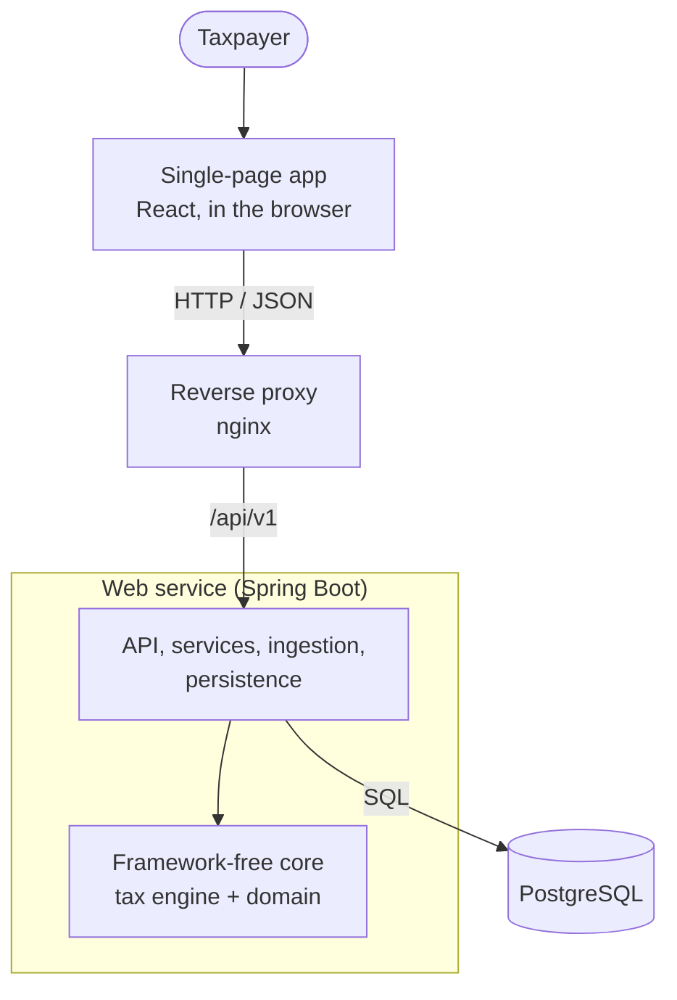

<figcaption><strong>High-level overview of the architecture.</strong></figcaption>
</figure>

### Framework-free core

Inside the web service, the layers are arranged around a **framework-free core**, following the *functional core, imperative shell* pattern. The tax rules are the most valuable and most delicate part of the system: they must be easy to test and must not change when the web framework, the database or a broker format changes. So the **domain** and **engine** packages contain plain Java only: the engine depends only on the domain, and the domain on nothing else. An automated architecture test fails the build if they depend on Spring, JPA, validation or JSON libraries, or if the domain depends on any other layer.

The core is a set of pure calculations: it receives plain lists of transactions, instruments and losses and returns results, without reading or writing anything itself.
All input and output happens in the surrounding layers: the **api** layer handles HTTP, **ingestion** turns broker files into domain objects, **persistence** stores and loads them, and the **service** layer loads the data, calls the core and saves what has to be saved.

This is close to a hexagonal architecture, but simpler: the core does not define ports that the outer layers implement, because it never needs to fetch data on its own. It is given everything it needs, which keeps it deterministic and easy to test with plain unit tests.

<figure>
  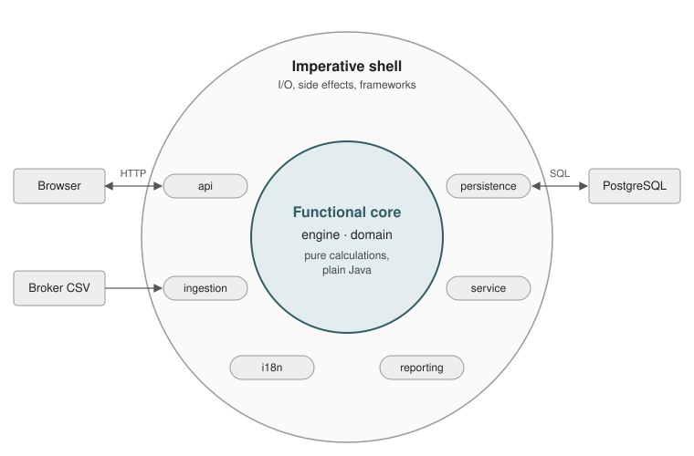
  <figcaption><strong>Functional core, imperative shell.</strong> The core (engine and domain) contains only pure calculations in plain Java. All input and output happens in the shell around it, and every dependency points inwards: the core knows nothing of the web framework, the files or the database.</figcaption>
</figure>

### Components and responsibilities

| Component                      | Responsibility                                                                                                                            |
| ------------------------------ | ----------------------------------------------------------------------------------------------------------------------------------------- |
| **Frontend** (single-page app) | Shows the pages, collects the user's input, calls the API, displays results and messages in the chosen language. It does no tax calculation; its only domain knowledge is the four-year limit of losses, used to warn about losses entered by hand. |
| **api** | REST controllers: binds HTTP requests to calls to the services, maps domain objects to DTOs, turns exceptions into standard error responses (RFC 9457). Business rules on input data are not checked here but in the domain objects and services, so they hold whatever the entry point. |
| **service** | Use cases: loads data from the repositories, calls ingestion, engine and reporting, saves the user's input (imports, classifications, prices, losses), defines transaction boundaries. Computed results are never saved. |
| **ingestion**                  | Reads a broker CSV, chooses the right parser from the header, turns each row into a broker-independent `Transaction` and validates it.    |
| **domain**                     | Entities and value objects of the problem (`Transaction`, `Instrument`, `Lot`, `Disposal`, `TaxableEvent`,..).                            |
| **engine**                     | Tax calculation: lot matching, classification of income, tax loss carryforward, IVAFE, portfolio, yearly rule sets.                       |
| **reporting**                  | Turns the results of a year into the values of quadri T, M and W of the Modello 730.                                                      |
| **persistence**                | JPA entities, repositories and database migrations; maps between entities and domain objects.                                             |
| **i18n**                       | Translates the messages produced by the core (codes with parameters) into Italian or English.                                             |
| **Database**                   | Stores transactions, instruments, prices and losses entered by the user.                                                                  |

<figure>
  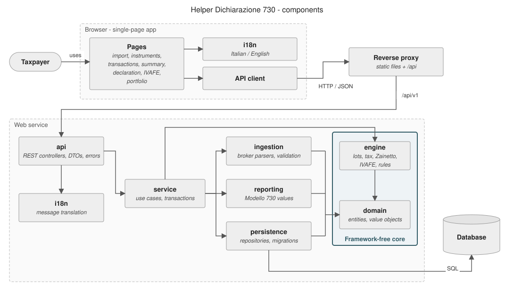
  <figcaption><strong>Component diagram.</strong> The browser talks only to the reverse proxy, which forwards API calls to the web service. Inside the service, every dependency points towards the framework-free core (engine and domain), a rule enforced by an automated architecture test; only the persistence layer accesses the database.</figcaption>
</figure>

## Infrastructure

The system has three infrastructural components, one instance each:

| Component                                | Role                                                                                     | Instances |
| ---------------------------------------- | ---------------------------------------------------------------------------------------- | --------- |
| **Web server / reverse proxy** (nginx)   | Serves the files of the single-page app and forwards `/api` requests to the web service. | 1         |
| **Application server** (the web service) | Exposes the REST API and runs the tax engine.                                            | 1         |
| **Database** (PostgreSQL)                | Persistent storage, with a volume that survives restarts.                                | 1         |

There are no load balancers, caches, queues or message brokers:there is one user per installation, whose history is typically a few hundred or a few thousand transactions, so one instance of each component is enough, and results are cheap to recompute.

**Distribution.** The three components run as containers on the **same machine**, the user's computer, on a private network created by Docker Compose. This keeps the user's financial data on their own machine (NFR-4).

**Naming and discovery.** Components find each other by **service name** through the DNS of the Compose network: the proxy forwards to `backend:8080`, the web service connects to `db:5432`. The browser talks only to the proxy (`localhost:3000`), so frontend and API share one origin and no cross-origin configuration is needed. During development the Vite dev server plays the role of the proxy.

<figure>
  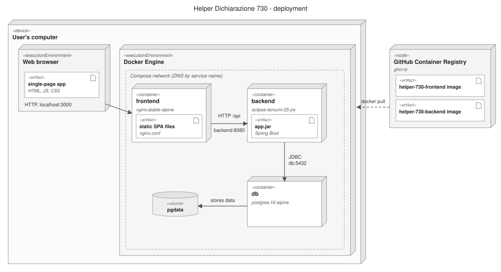
  <figcaption><strong>Deployment diagram.</strong> Everything runs on the user's computer: the browser and three containers on a private Docker Compose network, where they find each other by service name. Data is kept in the <code>pgdata</code> volume; released images can be pulled from GitHub Container Registry instead of being built locally.</figcaption>
</figure>

## Modelling

### Domain driven design (DDD) modelling

#### Bounded contexts

| Context | Purpose | Main concepts |
|:--|:--|:--|
| **Ingestion** | Bring broker data into the system. | Broker file, row, parser, row issue, import batch |
| **Instruments** | Know what each security is, for tax purposes. | Instrument, asset class, government bond share, foreign withholding rate |
| **Taxation** | Compute the substitute tax and the tax loss carryforward. | Lot, disposal, lot consumption, taxable event, income category, treatment, capital loss, tax year result |
| **Wealth tax** | Compute IVAFE on foreign holdings. | Holding period, year-end price, IVAFE row |
| **Declaration** | Express results in the language of the tax form. | Quadro, rigo, declaration item, warning |                                                              |

**Relations between contexts.**

- _Ingestion_ is upstream of everything else. It acts as an **anti-corruption layer**:
  each broker format is translated into the same `Transaction` model, so no other
  context knows about Revolut or Trade Republic.
- _Taxation_ and _Wealth tax_ both consume the transactions and share the lot-matching
  logic, but use it differently: Taxation needs the classification of each instrument to
  choose the cost method and the tax treatment, while Wealth tax always matches lots with
  LIFO to find the holding periods and values them with the prices at 31 December. So
  IVAFE can be computed even before the instruments are classified.
- _Declaration_ is downstream of Taxation, Wealth tax and Instruments. It **conforms** to
  the Modello 730, the "published language" of the tax authority, which the system cannot
  change.

<figure>
  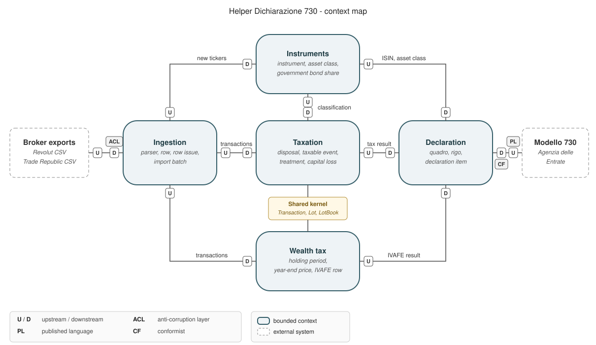
  <figcaption><strong>Context map.</strong> Ingestion is an anti-corruption layer between the broker formats and the rest of the system. Taxation and Wealth tax share a kernel of transactions and lots. Declaration is downstream of all contexts and conforms to the Modello 730, the published language of the tax authority.</figcaption>
</figure>

#### Domain concepts

| Concept | Kind | Notes |
|:--|:--|:--|
| `Transaction` | Entity | **Identity:** hash of the normalized row (or of the broker transaction id), so re-importing the same row gives the same identity. Immutable. |
| `Instrument` | Entity, aggregate root | **Identity:** ticker. Holds the classification chosen by the user. |
| `ImportBatch` | Entity | One import: file, broker, date, counters. Each stored transaction refers to the batch that brought it in. It belongs to the *Ingestion* context but has no domain class: the tax calculation never needs it, so it exists only as a persistence entity. |
| `Lot` | Value object | Units bought with one purchase and not yet sold, with cost including and excluding fees. |
| `Disposal`, `LotConsumption` | Value objects | A sale matched to the lots it consumed: the audit trail of each gain. |
| `TaxableEvent` | Value object | A sale or an income payment with its income category and taxable share. |
| `Treatment` | Value object | Income category plus taxable share (e.g. miscellaneous, 48.08%). |
| `CapitalLoss` | Value object | A loss in the carryforward: year, amount, residual, last usable year. |
| `ZainettoYear`, `TaxYearResult`, `IvafeResult` | Value objects | Results of a year, never stored. |
| `Declaration`, `DeclarationItem` | Value objects | Values to write in the tax form. |

**Repositories:** transactions, instruments, import batches, year-end prices, carried
losses.

**Domain services:**

- `LotBook`: matches sales to lots;
- `Classifier`: turns sales and income into taxable events;
- `Zainetto`: manages the tax loss carryforward;
- `TaxCalculator`, `IvafeCalculator`, `PortfolioCalculator`;
- `DeclarationBuilder`.

**Factories:**

- `RuleSetFactory`: chooses the tax rules of a year;
- `BrokerParserRegistry`: chooses the parser of a file;
- `Lot.of(purchase)`;
- `Instrument.unclassified(ticker)`.

**Domain events.** The relevant events are:

- _transactions imported_;
- _instrument classified_;
- _sale matched to lots_;
- _loss realized_;
- _loss used_;
- _loss expired_.

They are not published as messages. Results are recomputed from the full history at every
request, so each event is reflected by the next calculation without having to be
propagated (see _Behaviour_).

### Object-oriented modelling

The main data types and their relations:

- **`Transaction`** holds date, operation type, ticker, quantity, price and total amount.
  Methods: `taxYear()` (year in the Italian time zone), `impliedFee()`.
- **`Instrument`** holds ticker, ISIN, name, asset class, government bond share, foreign
  withholding rate. Methods: `isClassified()`, plus validation of the ISIN check digit
  and of the rates.
- **`Lot`** is created from a purchase. Methods: `costOf(part, includeFees)`,
  `remainderAfter(part)`.
- **`LotBook`** keeps the open lots of every instrument. Method: `apply(transaction)`,
  which opens a lot for a purchase and produces a `Disposal` for a sale.
- **`Disposal`** has one or more **`LotConsumption`**. Methods: `proceeds()`, `cost()`,
  `gain()`.
- **`Classifier`** turns a `Disposal` or an income `Transaction` into a **`TaxableEvent`**,
  using the **`Treatment`** given by a **`TaxRuleSet`**.
- **`Zainetto`** turns the taxable events of all years into a list of **`ZainettoYear`**,
  each with opening, used, expired and closing **`CapitalLoss`** values.
- **`TaxCalculator`** combines all of the above into a **`TaxYearResult`**.
- **`IvafeCalculator`** produces an **`IvafeResult`** made of **`IvafeRow`**s.
- **`DeclarationBuilder`** turns a `TaxYearResult` and an `IvafeResult` into a
  **`Declaration`** of sections and items.

Several variation points are modelled as **strategies**, so that new cases can be added
without changing existing code:

| Interface              | Implementations                        | What varies                                                 |
| ---------------------- | -------------------------------------- | ----------------------------------------------------------- |
| `BrokerParser`         | `RevolutParser`, `TradeRepublicParser` | the file format of each broker                              |
| `TaxRuleSet`           | `CurrentRegime`                        | the tax rules of a period                                   |
| `CostMethodPolicy`     | from the rules, or always LIFO         | how a sale is valued                                        |
| `CompensationStrategy` | `OLDEST_FIRST`                         | the order in which losses are used                          |
| `TransactionValidator` | future date, implied fee               | the checks on imported rows, chained in a `ValidationChain` |

<figure>
  
  <figcaption><strong>Class diagram overview: domain and tax engine.</strong> <code>TaxCalculator</code>
  replays the purchase lots, classifies sales and income with the rules of the year, runs the tax loss carryforward and returns the result of the year. Every taxable event keeps a link to its source transaction and to the lots it consumed.</figcaption>
</figure>

<figure>
  
  <figcaption><strong>Class diagram overview: ingestion, IVAFE and reporting.</strong> A registry picks the parser of each broker, whose rows go through a chain of validators. The IVAFE calculator derives holding periods from the transactions, and the declaration builder turns the tax and IVAFE results into the sections of the Modello 730. Classes marked «core» belong to the previous diagram.</figcaption>
</figure>

<figure>
  
  <figcaption><strong>Class diagram: domain and tax engine, detailed.</strong> Attributes and main methods of each class. Variation points are interfaces: <code>TaxRuleSet</code> for the rules of a period, <code>CostMethodPolicy</code> for LIFO or weighted average cost, <code>CompensationStrategy</code> for the order in which losses are used.</figcaption>
</figure>

<figure>
  
  <figcaption><strong>Class diagram: ingestion, IVAFE and reporting, detailed.</strong> Each broker parser produces a <code>ParseResult</code> with valid transactions, the instruments found in the file and the issues of invalid rows. <code>Mappings</code> holds the rows and codes of the Modello 730 for each tax year.</figcaption>
</figure>

### Distributed aspects

The system is distributed only between browser, web service and database.

- **Domain concepts and components.** All domain concepts live in the web service; the database stores only the inputs (transactions, instruments, prices, losses), never the results.
- **State.** The state of the system is the content of the database. The frontend keeps
  only what concerns the view: the loaded data, the form being edited and the chosen year
  live in memory; the current page is in the URL and the chosen language is remembered in
  the browser's local storage. Neither is business data.
- **Messages.** Browser and web service exchange JSON **data transfer objects**, one per
  resource: transactions, instruments, tax year, IVAFE, declaration, portfolio. Texts meant
  for the user travel as a _message_ object with a code, its parameters and the text
  already translated by the server. The frontend shows the text as it is, and uses the code
  only when it must react: for example, it hides the warning about missing prices at
  31 December until the year is over. Errors use the same idea: their code tells the
  frontend, for example, to list the instruments still to classify.

## Interaction

Communication is **synchronous request-response** over HTTP, always started by the browser after a user action or when a page opens. The web service never contacts the browser. The API follows the **REST** style: resources identified by URLs, versioned under `/api/v1`.

| Resource                                                      | Operations                                                                   |
| ------------------------------------------------------------- | ---------------------------------------------------------------------------- |
| `/imports`                                                    | `POST` a CSV file (multipart), `GET` the import history                      |
| `/instruments`                                                | `GET` the list, `PUT /{ticker}` the classification, `DELETE` the unused ones |
| `/transactions`                                               | `GET` the list, `DELETE` all                                                 |
| `/prices/{year}`                                              | `GET`, `PUT` the prices at 31 December of a year                             |
| `/carried-losses`                                             | `GET`, `PUT` the losses of previous years                                    |
| `/tax/years`                                                  | `GET` the years with operations                                              |
| `/tax/{year}`, `/tax/{year}/ivafe`, `/tax/{year}/declaration` | `GET` the results of a year                                                  |
| `/portfolio`                                                  | `GET` the current holdings                                                   |

Interaction patterns:

- **Replace-whole-list.** Prices and losses of previous years are sent and stored as a
  whole list, which keeps the client simple and the update atomic.
- **Content negotiation for language.** The browser sends the chosen language in the
  `Accept-Language` header, and the server returns messages translated accordingly.
- **Standard errors.** Errors are returned as _problem details_ (RFC 9457), with a code
  the client can react to: for example, 409 with the list of unclassified instruments.

Typical interactions:

1. **Import:** the browser posts the file; the service parses, validates, discards
   duplicates, registers new instruments and saves everything in one transaction; the
   browser shows the report and reloads the list of years.
2. **Tax of a year:** the browser asks for `/tax/{year}`; the service loads all
   transactions, instruments and losses, runs the engine and returns the result.

<figure>
  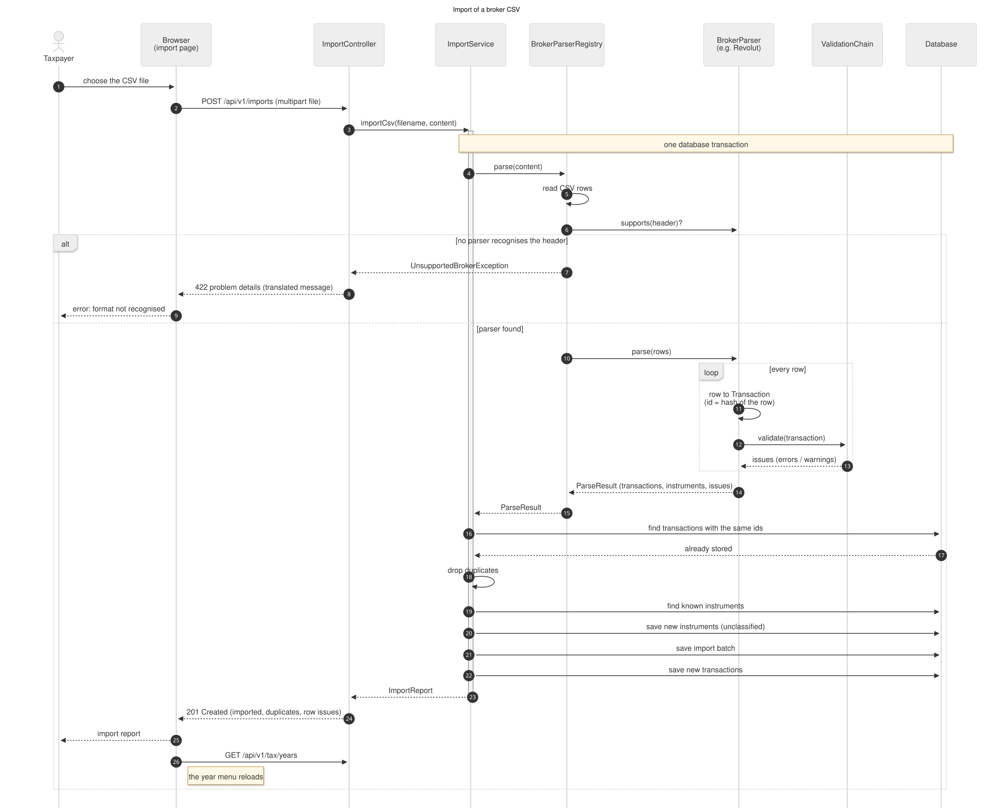
  <figcaption><strong>Import of a broker CSV.</strong> The registry picks the parser from the file header; each row becomes a transaction and is validated. Duplicates are dropped by their content hash, new instruments are registered as unclassified, and everything is saved in a single database transaction. An unknown format is answered with a 422 problem detail.</figcaption>
</figure>

<figure>
  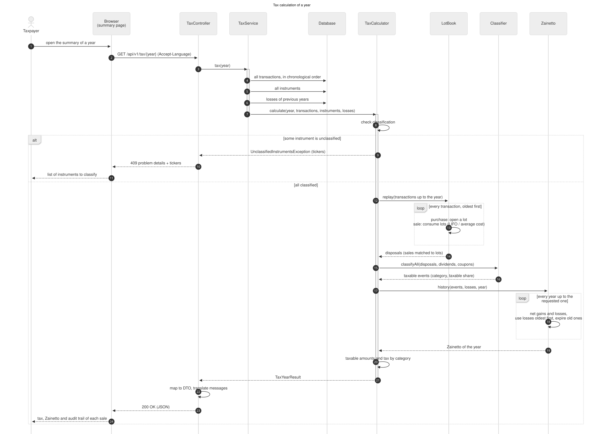
  <figcaption><strong>Tax calculation of a year.</strong> The service loads the whole history, because lots and losses depend on earlier years. Sales are matched to lots, classified into taxable events and netted in the tax loss carryforward. If an instrument is not classified, the API answers 409 with the list of tickers to fix.</figcaption>
</figure>

## Behaviour

**Web service: stateless.** It keeps no state between requests. Write requests change the database; read requests compute their answer from it. This is why every result always reflects the latest data (NFR-3), and why the calculation of a year always starts from the first transaction: lots and losses depend on all the years before it.

**Database: the only state of the system.** It is updated in four moments, each in a single database transaction:

- an **import** adds a batch, its transactions and any new instruments;
- a **classification** updates one instrument;
- **saving prices or losses** replaces the list of a year, or the whole list;
- a **deletion** removes all transactions and the import history; optionally it also
  removes the prices at 31 December and the instruments left unused. The losses of
  previous years entered by hand are kept.

**Tax engine: a pure function of its inputs.** Given the same transactions,
classifications and losses, it always gives the same result. Its main stateful objects are created and discarded within a single calculation:

- the **lot**: _open_ on purchase, _partially consumed_ by a sale of part of it, _closed_ when fully sold;
- the **capital loss**: _realized_ at the end of a year with a net loss, _available_ from the next year, _partially used_ or _used up_ by later gains, _expired_ after four years;
- the **instrument**: _unclassified_ when first seen in an import, _classified_ when the user chooses its asset class; it can be reclassified at any time, and the next calculation uses the new class.

**Frontend: reacts to user actions.** After an action that changes data (import, deletion, classification, saving losses) it reloads the affected data, such as the list of years and the page shown.

<figure>
  
  <figcaption><strong>Lot.</strong> A purchase opens a lot; sales consume it, newest lots first with LIFO, or every lot by the same fraction with the weighted average cost. Lots exist only during a calculation, which replays the whole history.
  </figcaption>
</figure>

<figure>
  
  <figcaption><strong>Capital loss in the Zainetto.</strong> A net loss becomes available from the next year and offsets miscellaneous gains, oldest loss first, until it is used up or expires at the end of the fourth following year.
  </figcaption>
</figure>

<figure>
  
  <figcaption><strong>Instrument.</strong> A new ticker found in an import is unclassified until the user chooses its asset class. Taxes cannot be computed while an instrument used in the year is unclassified; a change of classification is applied by the next calculation.
  </figcaption>
</figure>

<figure>
  
  <figcaption><strong>Tax calculation of a year.</strong> First the whole history is replayed: purchases open lots and sales consume them with the cost method of the asset class. Then every sale and income payment is classified, the tax loss carryforward is run year by year, and the substitute tax is computed. Red boxes are the cases in which the calculation stops with an error.
  </figcaption>
</figure>

## Data-related aspects

**What is stored, and why.** Only the data that cannot be derived:

- the imported transactions;
- the instruments with their classification;
- the prices at 31 December;
- the losses of previous years;
- the history of imports.

Everything else (lots, gains, taxes, IVAFE, declaration) is derived and recomputed on request. This avoids keeping copies in sync and makes results always consistent with their inputs.

**How.** In a **relational** database, because:

- the data is tabular and strongly structured (a transaction always has the same fields);
- it has clear relations (a transaction refers to an instrument and to an import);
- the database can enforce rules with foreign keys and check constraints, such as the
  format of an ISIN, the known asset classes and positive prices, as a second line of
  defence after the checks of the domain (which also verifies the ISIN check digit);
- amounts can be stored as exact decimal numbers.

ACID transactions guarantee that an import is stored entirely or not at all. The schema
is versioned with migrations applied at startup.

| Table             | Content                                                                                          |
| ----------------- | ------------------------------------------------------------------------------------------------ |
| `transactions`    | One row per imported operation; primary key is the content hash, which makes imports idempotent. |
| `instruments`     | One row per ticker, with its classification.                                                     |
| `import_batches`  | One row per uploaded file.                                                                       |
| `year_end_prices` | One price per ticker and year.                                                                   |
| `carried_losses`  | One loss per year.                                                                               |

**Queries.** Only the web service accesses the database, through its repositories:

- an **import** looks up the ids of the incoming transactions, to find duplicates, and the
  incoming tickers, to find new instruments; then it inserts;
- a **calculation** reads all transactions in chronological order, all instruments, the
  losses and, for IVAFE, the prices of the year and of the year before;
- the **pages** read lists: transactions, instruments, imports.

Concurrency is low: one user, usually one request at a time. Reads run in read-only
transactions; each write runs in a single transaction, so concurrent requests cannot
observe a half-finished import.

**Shared data.** The database is not shared with other systems. The only data shared
between components is the content of the API messages, described in _Modelling_.

<figure>
  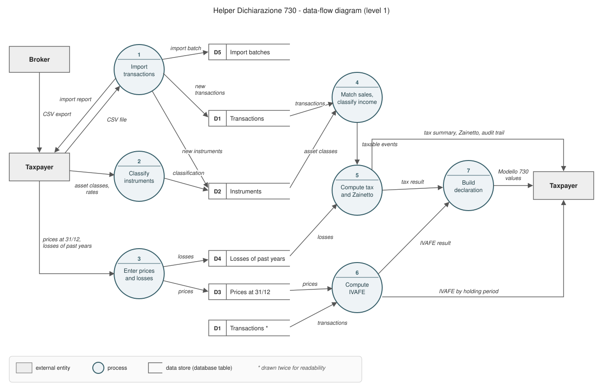
  <figcaption><strong>Data-flow diagram (level 1).</strong> The taxpayer's inputs (broker file, classifications, prices and past losses) are the only data stored. Processes 4 to 7 only read the data stores: lots, taxes, IVAFE and the declaration values are computed on each request and sent back to the taxpayer, never stored. 
  </figcaption>
</figure>
<!-- Level 1 means that the unique circle that represents all the system gets decomposed into the principal processes (the 7 numbered circles) -->