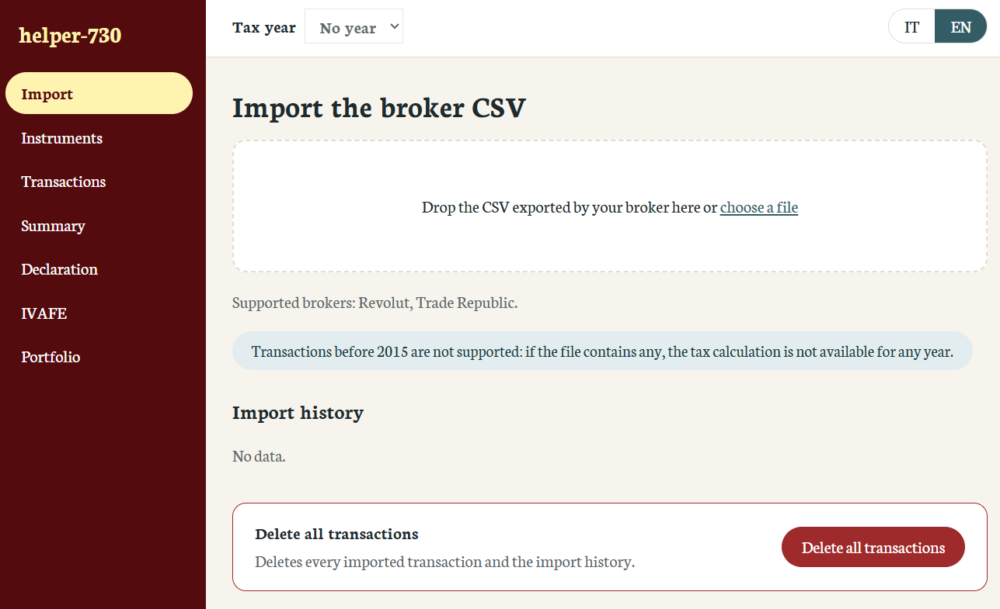
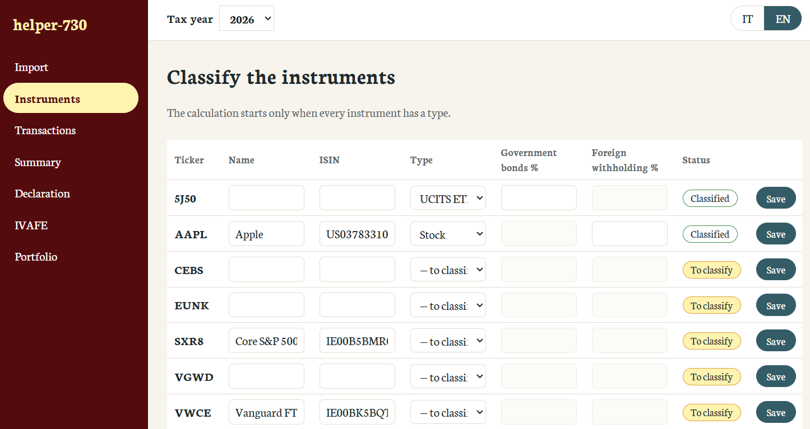
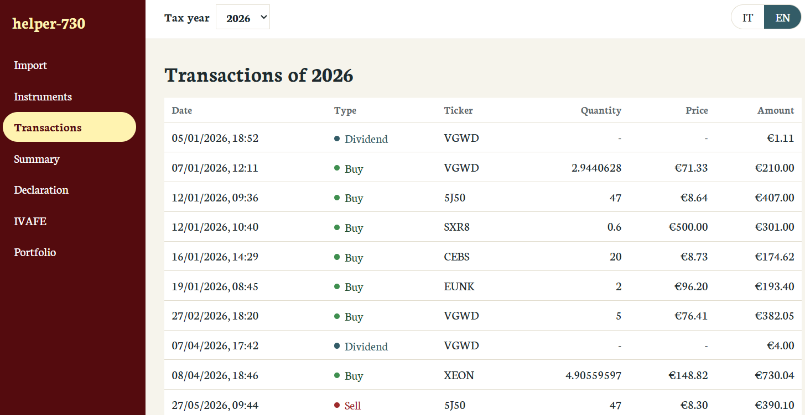
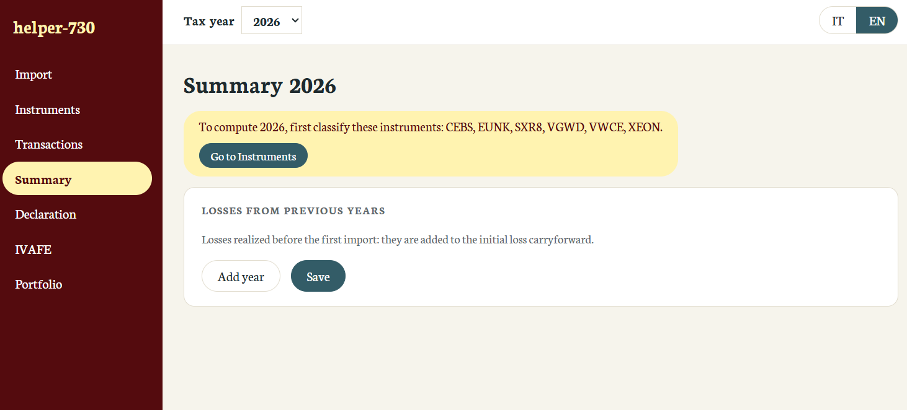
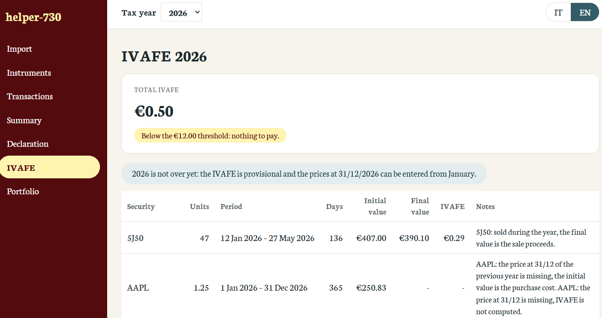
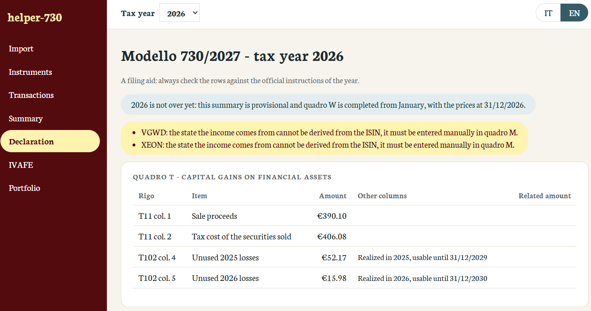
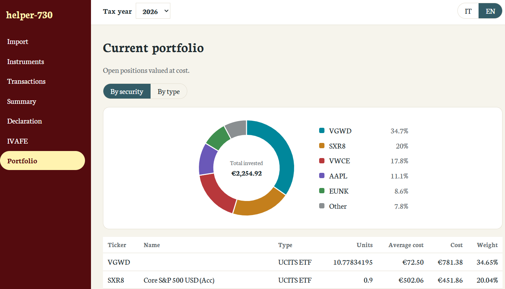

# User Guide

Open **<http://localhost:3000>** in the browser. The top bar has the **Tax year** menu, which chooses the year shown by the summary, the declaration and the IVAFE pages, and the **language** switch (Italian / English). The sidebar lists the pages in the order they are normally used.

## Doing your tax return, step by step

1. **Export the transactions from your broker** as CSV. Export the **whole history**, from
   your first purchase: the tax of a year depends on the purchases of earlier years.
   - *Revolut*: the trading account statement, in CSV.
   - *Trade Republic*: the transaction export, in CSV.
2. **Import** the file (*Import* page).
3. **Classify** the new instruments (*Instruments* page).
4. Enter the **losses of previous years**, if any (*Summary* page).
5. After the year is over, enter the **prices at 31 December** (*IVAFE* page).
6. Copy the values of the **declaration** into your Modello 730 (*Declaration* page).

The next sections describe each page.

## Import

Drag the CSV onto the box, or click **choose a file**. The application recognises the broker by itself and shows a report:

- **Imported**: new transactions saved;
- **Duplicates**: rows already imported before. Uploading the same file again, or a newer export that overlaps the old one, is safe and adds nothing twice;
- **Rows with errors**: rows that could not be imported, listed with their row number and the reason (for example a corporate action such as a stock split, or a currency other than euro). The other rows are imported anyway. *Warnings* (for example an unusually high fee) do not stop the row from being imported.

<figure>
  
  <figcaption><strong>Import.</strong> The report of the last import (imported rows, duplicates,
  rows with errors) and the history of the files imported so far.</figcaption>
</figure>

Below there is the **Import history**. At the bottom, **Delete all transactions** removes every transaction and the history, after a confirmation. Tick *Also delete the instruments left without transactions* to also remove the instruments and the prices you entered.

> Transactions before 2015 are not supported: if the file contains them, no tax year can
> be computed.

## Instruments

Every security found in your files appears here, and must be given a **Type** before any tax can be computed. 

<figure>
  
  <figcaption><strong>Instruments to classify.</strong> Every security found in the imported files is listed; those without a type are marked as <em>To classify</em>.</figcaption>
</figure>

Choose among:

| Type | Use it for |
|---|---|
| Stock | Shares of companies. |
| Bond | Corporate bonds. |
| Government bond (white list) | Bonds of Italy and of states on the white list (e.g. EU countries): taxed at 12.5%. |
| Government bond (non white list) | Bonds of other states: taxed at 26%. |
| UCITS ETF | Most ETFs sold in Europe (their name or factsheet says "UCITS"). |
| Non-UCITS ETF | ETFs not compliant with the UCITS directive: excluded from the calculation, with a warning. |
| ETC / ETN | Exchange-traded commodities and notes. |

For some types you can fill in two more fields:
- **Government bonds %**, for a UCITS ETF: the share invested in government bonds, from
  the ETF's factsheet. That part is taxed at 12.5%.
- **Foreign withholding %**, for stocks and bonds: the tax withheld abroad on dividends or
  coupons, for example 15% on US dividends. The application uses it to compute the gross
  amount, which is what is taxed in Italy.

The **Status** column shows which instruments are still *To classify*.

<figure>
  
  <figcaption><strong>Instruments classified.</strong> Each instrument has its type and, where relevant, the share of government bonds or the foreign withholding rate.</figcaption>
</figure>

## Transactions

The list of the imported transactions of the selected year: date, ticker, type, quantity, price and amount.

## Summary

The result of the selected year:

- at the top, **what you owe**. If the total tax is below 12 euro, nothing has to be paid.
  Next to it, the **economic result** of the year: what you actually gained or lost, fees included;
- **Miscellaneous income** (gains and losses on sales) and **Capital income** (dividends, coupons, gains on UCITS ETFs), each with its taxable amount and tax;
- the **Loss carryforward**: losses still available at the end of the year, each with the last year in which it can be used, and what was used this year;
- **Where every euro comes from**: every sale and income payment of the year. **Click a sale** to see the purchase lots it consumed, with their date, quantity, cost and proceeds.

At the bottom, **Losses from previous years**: if you had losses before your first imported year (for example at another broker), add them here with **Add year**, then **Save**. A warning appears if you enter a loss for a year you have already imported (it could be counted twice) or one that had already expired.

<figure>
  
  <figcaption><strong>Summary of a year.</strong> Tax by income category, the loss  carryforward with the expiry of each loss, and the audit trail: a sale expanded into the purchase lots it consumed.</figcaption>
</figure>

If some instruments are not classified yet, the page lists them, with a button that leads to *Instruments*.

## IVAFE

The wealth tax on your foreign holdings, one row per holding period, with the days held, the initial and final value and the tax.

The values at year end need the **prices at 31/12**. Enter the closing price of the last trading day of the year for each security (from your broker or a financial website), then click **Save prices and recompute**. Until the year is over, the prices cannot be known, so the page is provisional.

Cash left on the broker account is not included in the calculation: if its average balance over the year was above 5,000 €, add the account to quadro W by hand (the page shows a reminder).

<figure>
  
  <figcaption><strong>IVAFE.</strong> One row per holding period with days held, initial and final value and tax; below, the prices at 31 December used to value the holdings.</figcaption>
</figure>

## Declaration

The values to write in the **Modello 730**, grouped by quadro:

- **Quadro T**: proceeds and costs of the sales (T11), and the losses to carry forward (T102);
- **Quadro M**: foreign capital income (M31), by income code, state and rate, with the foreign tax withheld;
- **Quadro W**: your foreign holdings, with the codes to write in the other columns and the IVAFE.

For each value the table shows the **rigo** and the column. The **warnings** at the top list what the application could not fill in by itself, for example a missing price or an unknown country: complete those boxes by hand.

<figure>
  
  <figcaption><strong>Declaration.</strong> The values to copy into the Modello 730, with the rigo and column of each one and the warnings on what must be completed by hand.</figcaption>
</figure>

> The declaration is an aid: always check the values against the official instructions of
> the year before filing.

## Portfolio

Your current holdings at cost, by security and by type, with their weight on the total invested.

<figure>
  
  <figcaption><strong>Portfolio.</strong> Current holdings at cost, by security and by type, with the weight of each on the total invested.</figcaption>
</figure>

## If something goes wrong

| Message | What to do |
|---|---|
| *The backend is not responding* | The application is not running: start it with `docker compose up -d` (see [Deployment](../07-deployment)). |
| *File format not recognized* | The file is not a CSV export of Revolut or Trade Republic, or it was modified. Export it again from the broker. |
| *To compute … first classify these instruments* | Open *Instruments* and give a type to the listed ones. |
| A sale exceeds the shares held | The file does not contain the whole history: export it again from your first purchase. |
| *Prices at 31/12 are missing* | Enter them in the *IVAFE* page. |